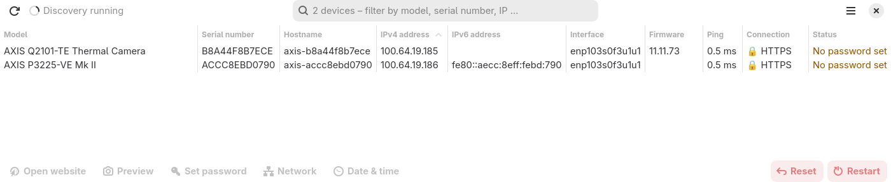

# Axis IP Tool

GNOME app and command line tool for finding Axis network cameras and doing their basic
configuration – modeled on the **AXIS IP Utility**.
Not an official product of Axis Communications AB.



## Features

| Feature | Implementation |
|---|---|
| Discover devices | Bonjour/mDNS via Avahi (D-Bus) + SSDP/UPnP |
| Continuous monitoring | ping every second, query every 10 s; offline after 10 s without reply |
| Model, serial number, firmware | `basicdeviceinfo.cgi` (without login, with login for locked devices) |
| IPv6 address and interface | Avahi + kernel neighbor table; link-local preferred, EUI-64 from the MAC |
| Open web interface via IPv6 | link-local addresses via a local forwarding (browsers can't open `fe80::…%iface` URLs) |
| Detect factory state / initial password | `systemready.cgi`, `pwdgrp.cgi` |
| Commissioning: power line frequency, mounting position | `param.cgi` (50/60 Hz; ceiling/wall/desk) |
| IPv4 (DHCP/static), hostname, DNS | `network_settings.cgi`, fallback `param.cgi` |
| Time zone + time | `time.cgi`, fallback `date.cgi` |
| NTP servers | `ntp.cgi`, fallback `param.cgi` |
| Preview image | `jpg/image.cgi` (1 image/s) |
| Several devices at once | password, sequential IPs, hostname pattern, time/NTP; CSV plan; log |
| Open website, restart | default browser, `restart.cgi` |
| Factory defaults (optionally including IP) | `factorydefault.cgi` / `hardfactorydefault.cgi` |

## Installation

**One command** (Fedora, Ubuntu/Debian, Arch; x86_64 and arm64; Silverblue & co. automatically
get the Flatpak variant):

```sh
curl -fsSL https://github.com/reschcloud/axis-ip-tool-linux/releases/latest/download/install.sh | sh
```

Remove:

```sh
curl -fsSL https://github.com/reschcloud/axis-ip-tool-linux/releases/latest/download/install.sh | sh -s -- --uninstall
```

**Manually:** download the package from the release page and install it, e.g.
`sudo dnf install ./axis-ip-tool*.rpm` or `sudo apt install ./axis-ip-tool*.deb`.
The package manager pulls in the dependencies (GTK 4, libadwaita ≥ 1.5).

**From source:**

```sh
# Fedora: sudo dnf install golang gtk4-devel libadwaita-devel gobject-introspection-devel
# Ubuntu: sudo apt install golang libgtk-4-dev libadwaita-1-dev libgirepository1.0-dev
make            # the first build takes ~10–15 min because of the GTK bindings
sudo make install
sudo make uninstall
```

## Updating

The app doesn't update itself. Menu → "About Axis IP Tool" or `axisctl version` shows the
installed version; new versions are on the
[release page](https://github.com/reschcloud/axis-ip-tool-linux/releases).

**Installed with the install command** (package or Flatpak): just run the same command again –
it downloads the latest version and replaces the installed one:

```sh
curl -fsSL https://github.com/reschcloud/axis-ip-tool-linux/releases/latest/download/install.sh | sh
```

**Installed manually:** download the new package from the release page and install it the same
way as the first time (`sudo dnf install ./axis-ip-tool*.rpm`, `sudo apt install ./axis-ip-tool*.deb`
or `sudo pacman -U ./axis-ip-tool*.pkg.tar.zst`) – the package manager replaces the old version.

**From source:**

```sh
git pull
make
sudo make install
```

## Command line

```sh
axisctl list                                   # discover devices
axisctl init 192.168.0.90                      # create the first admin (50 Hz, ceiling mount)
axisctl init 192.168.0.90 -freq 60 -mount wall # … with other commissioning settings
axisctl net 192.168.0.90 -ip 10.0.0.20/24 -gw 10.0.0.1 -hostname camera-yard
axisctl time 192.168.0.90 -tz Europe/Vienna -ntp pool.ntp.org
axisctl reset 192.168.0.90                     # factory defaults (IP is kept; -all: IP too)

# Several cameras: sequential IPs from .20, hostnames camera-01, camera-02 …
axisctl batch -init -ip 10.0.0.20/24 -gw 10.0.0.1 -hostname 'camera-##' \
              -ntp pool.ntp.org ACCC8E000001 ACCC8E000002 ACCC8E000003
axisctl batch -ip 10.0.0.1/24 -csv plan.csv -dry-run   # assignment from CSV, show only
```

### Batch configuration

Select several devices in the list (Ctrl/Shift + click, Ctrl+A) → **Configure multiple**.
A wizard asks for the shared settings, shows a preview with the planned addresses and hostnames
(editable individually, conflicts are highlighted) and configures the devices one after another.
At the end a log can be saved as CSV.

Hostnames: fixed text plus `#` for a sequential number (`camera-##` → camera-01, camera-02 …,
start value configurable) and/or `@` for the last octet of the IP address
(`cam-@` → cam-20 for 10.0.0.20).

Instead of an address range, a **CSV file** can define the assignment (separator `;`, `,` or tab,
header row optional):

```csv
Serial;IP;Hostname
ACCC8E000001;10.0.0.20;camera-entrance
ACCC8E000002;10.0.0.21;camera-yard
```

## Structure

```
cmd/axis-ip-tool     GNOME app (Go, gotk4 + libadwaita)
cmd/axisctl          CLI (pure Go)
internal/axis        discovery, VAPIX client, data model
data/                desktop file, metainfo, icons, screenshots
packaging/           nfpm configuration, Flatpak manifest, install.sh, package scripts
```

## Notes

- Devices are found in the same network segment (multicast is not routed).
- SSDP replies arrive on a random UDP port. A strict firewall may block them; the mDNS
  discovery via Avahi is not affected.
- Ping uses unprivileged ICMP sockets (`net.ipv4.ping_group_range`, allowed by default on
  current distributions). Without them, reachability is checked via HTTP only.
- Communication with the cameras uses **HTTPS** if the device offers it, otherwise HTTP
  (column "Connection"). The cameras' self-signed certificates are accepted without
  verification: encrypted, but no protection against an active attacker on the network.
  Menu → "Use HTTPS only" or `axisctl --https-only` forbids the fallback to HTTP.
- Screenshot for this README: `AXIS_IP_TOOL_SCREENSHOT=data/screenshots/main-window.png axis-ip-tool`
  renders the window after a few seconds and quits.

## License

Copyright © 2026 Michael Resch

This program is free software: you can redistribute it and/or modify it under the terms of the
[GNU Affero General Public License](LICENSE) as published by the Free Software Foundation,
either version 3 of the License, or (at your option) any later version. It is distributed
without any warranty.
